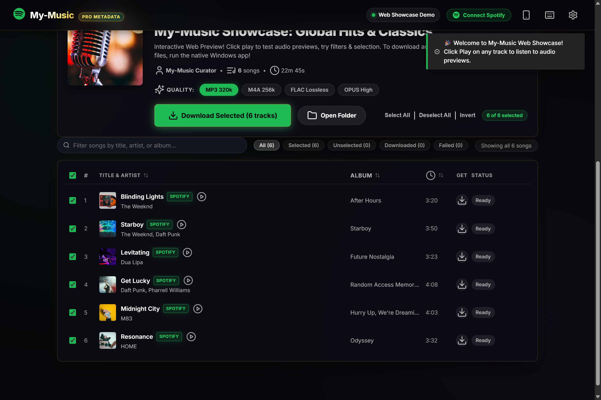
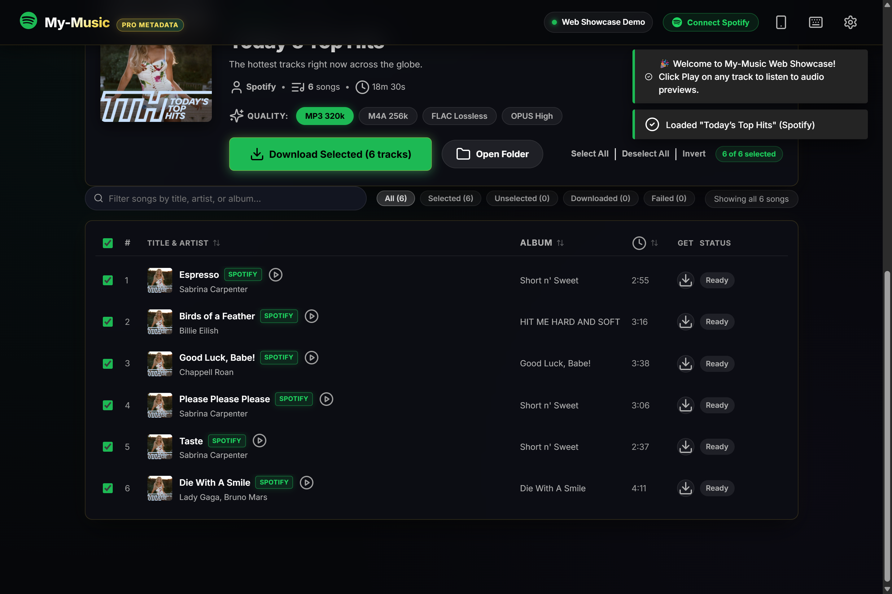
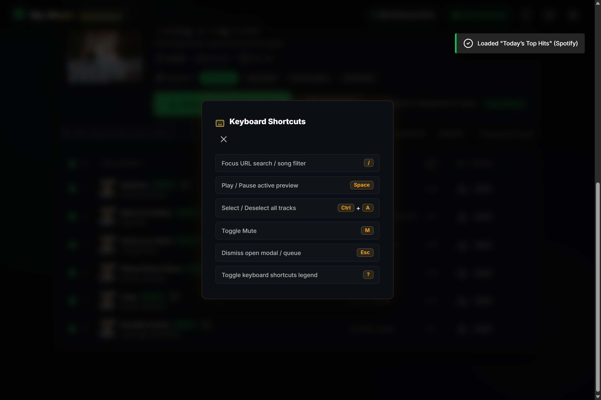
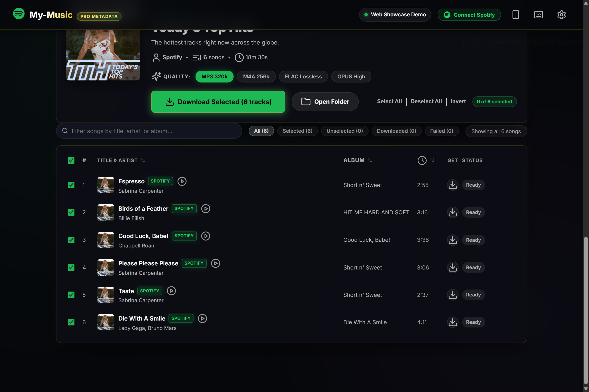
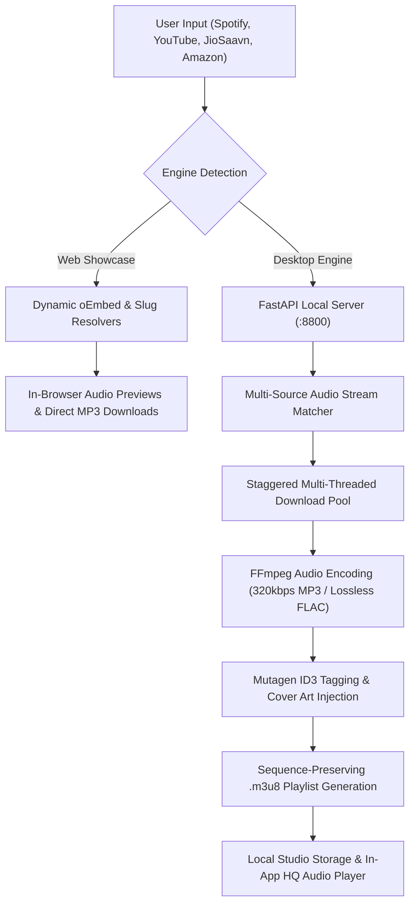

<div align="center">


# 🎵 My-Music
### Studio-Grade Multi-Platform Music & Playlist Downloader
**High-Bitrate 320kbps MP3 & Lossless FLAC • Authentic ID3 Tagging • In-Browser Audio Previews**

<br />

[](https://sudo-shakuni.github.io/my-music/)
[](https://github.com/sudo-shakuni/my-music/releases/latest)
[](LICENSE)
[](https://www.python.org/)
[](https://fastapi.tiangolo.com/)
[](README.md)
[](README.md)

<br />

<p align="center">
  <a href="https://sudo-shakuni.github.io/my-music/">
    
  </a>
  &nbsp;&nbsp;
  <a href="https://github.com/sudo-shakuni/my-music/releases/latest/download/my-music-v2.0.0-Windows.zip">
    
  </a>
</p>

<p align="center">
  <b>My-Music</b> is an ultra-fast, zero-cost desktop & web application designed to clone and download playlists, albums, and singles from <b>Spotify</b>, <b>YouTube & YouTube Music</b>, <b>JioSaavn</b>, and <b>Amazon Music</b> in studio-grade audio quality (up to 320 kbps MP3 & lossless FLAC) with authentic metadata, high-resolution cover art, and sequence-accurate <code>.m3u8</code> playlist cloning.
</p>

[🌐 Live Web Demo](https://sudo-shakuni.github.io/my-music/) • [📸 Screenshots](#-screenshots--ui-tour) • [✨ Features](#-key-features) • [🎛️ Audio Presets](#️-audio-quality-presets) • [🚀 Quick Start](#-quick-start) • [⌨️ Shortcuts](#️-keyboard-shortcuts) • [📂 Architecture](#-system-architecture)

</div>

---

## 📸 Screenshots & UI Tour

<table align="center" width="100%">
  <tr>
    <td width="50%" align="center">
      
      <br />
      <b>👑 Obsidian & Gold Hero Search Section</b>
      <br />
      <sub>Universal input bar with multi-platform pills (Spotify, YouTube, JioSaavn, Amazon) and instant quick samples</sub>
    </td>
    <td width="50%" align="center">
      
      <br />
      <b>🎧 Rich Playlist Showcase & Audio Previews</b>
      <br />
      <sub>Instant in-browser streaming, 320k/FLAC quality pills, smart filter chips, and selective batch downloads</sub>
    </td>
  </tr>
  <tr>
    <td width="50%" align="center">
      
      <br />
      <b>⌨️ Keyboard Shortcuts Legend Modal</b>
      <br />
      <sub>Instant accessibility cheat sheet for power users with sleek glowing key caps</sub>
    </td>
    <td width="50%" align="center">
      
      <br />
      <b>⚙️ Studio Output & Concurrency Settings</b>
      <br />
      <sub>Configure audio formats (MP3/FLAC/AAC/OPUS), bitrates, file naming patterns, and download concurrency</sub>
    </td>
  </tr>
</table>

---

## 🌐 Universal Platform Support

| Platform | Supported Formats | Features & Capabilities |
| :--- | :--- | :--- |
| **🟢 Spotify** | Playlists, Albums, Singles, Liked Songs | Real CORS oEmbed metadata, artist resolution, high-res cover art, track sequencing |
| **🔴 YouTube & YT Music** | Videos, Music Singles, Playlists | Direct oEmbed resolution, live video metadata extraction, lossless audio stream extraction |
| **🔵 JioSaavn** | Tracks, Albums, Playlists | High-bitrate 320kbps Bollywood & Regional audio masters, slug metadata parsing |
| **🟠 Amazon Music** | Albums, Playlists, Tracks | Curated originals & hits resolution with album position numbering |
| **🔎 Free-Text Search** | Artist & Song Title Queries | Type any song query (e.g. `Coldplay Yellow`) for immediate interactive loading |

---

## ✨ Key Features

- **⚡ 100% Free & Zero API Keys Required**:
  - Leverages public oEmbed and stream architectures to resolve track information without paid accounts or rate-limited credentials.
  - Matches audio against high-bitrate multi-source streams with automated fallback logic.
- **🏷️ Authentic Studio Metadata Tagging**:
  - Automatically embeds complete ID3 tags via Mutagen: Title, Artists, Album, Release Date, Track Numbering, and Disc Position.
  - Injects full-resolution album cover art directly into audio files (`APIC` / `covr`).
- **📑 Sequence-Preserving Playlist Cloning (`.m3u8`)**:
  - Generates `.m3u8` playlist files alongside your audio files so you can import playlists into VLC, Foobar2000, Apple Music, or mobile media players with exact sequence ordering.
- **🎧 Built-in Studio HQ Audio Player**:
  - Listen to audio previews directly in the browser or desktop window.
  - Once downloaded, click the **Glowing Green (HQ)** badge to stream the full studio-quality track directly from your local disk with waveform seek controls.
- **🚀 Ultra-Fast Multi-Threaded Engine**:
  - Download up to 6 tracks simultaneously with staggered thread pooling and bot-proof rate-limit protections.
  - Live speedometer (`⚡ MB/s`), dynamic ETA calculator, and slide-up active queue drawer.
- **🔄 Smart 1-Click Retry Mechanism**:
  - Automatically isolates failed downloads and displays a **⚡ Retry Failed Tracks** button to re-queue them in one click.
- **🔍 60 FPS Progressive Virtual Rendering**:
  - Smooth virtual batching handles massive 2,500+ track playlists without dropping frames.
  - Filter by **All**, **Selected**, **Unselected**, **Downloaded**, or **Failed** with live count badges.
  - Full **Shift-Click range selection** and filter-scoped selection.
- **🔗 Spotify Account Integration & Library Downloads**:
  - Connect your personal Spotify account via 1-click browser OAuth or access token.
  - Browse your entire Spotify library inside My-Music: personal playlists, collaborative collections, and **Liked Songs**.
- **📋 Automatic Clipboard Detection**:
  - Auto-detects copied Spotify, YouTube, JioSaavn, or Amazon Music links upon focusing the window for 1-click loading.

---

## 🎛️ Audio Quality Presets

| Format | Bitrate / Quality | Best For | Compatibility |
|---|---|---|---|
| **MP3** | `320 kbps` (Maximum HQ) | Universal compatibility, car stereos, DJ equipment | 100% All Devices |
| **FLAC** | `Lossless Source` | Audiophile archiving, studio reference monitors | High-Fidelity Audio |
| **M4A / AAC** | `256 kbps` (High) | Apple devices, iPhone, iPad, macOS, QuickTime | Apple Ecosystem |
| **OPUS** | `256 kbps` (Modern) | Best quality-to-size ratio, Discord & modern web | Modern Players |
| **WAV** | `Uncompressed PCM` | Audio editing, DAWs, sound design | Professional Production |

---

## ⚡ Quick 1-Click Install (Windows PowerShell)

Run this single command in PowerShell to automatically download, unpack, and launch My-Music with a Desktop shortcut:

```powershell
irm https://raw.githubusercontent.com/sudo-shakuni/my-music/main/install.ps1 | iex
```

---

## 🚀 Quick Start

### Windows Desktop (One-Click)
Simply run either launcher from the project folder:
- **`my-music.bat`** (or `run.bat`) — Initializes the Python environment, installs dependencies, verifies the FFmpeg engine, and launches the native desktop window.
- **`my-music.vbs`** — Launches the application silently without opening a terminal background window.

```powershell
# Or launch directly from terminal
python desktop.py
```

---

### Manual Setup (All Platforms)

1. **Clone the repository**:
   ```bash
   git clone https://github.com/sudo-shakuni/my-music.git
   cd my-music
   ```

2. **Create and activate a virtual environment**:
   ```bash
   # Windows
   python -m venv .venv
   .\.venv\Scripts\activate

   # macOS / Linux
   python3 -m venv .venv
   source .venv/bin/activate
   ```

3. **Install dependencies**:
   ```bash
   pip install -r requirements.txt
   ```

4. **Verify FFmpeg audio engine**:
   ```bash
   python setup_ffmpeg.py
   ```

5. **Start My-Music**:
   ```bash
   # Native Desktop Window (Windows / macOS)
   python desktop.py

   # Web Server Only (Headless / Docker)
   python backend/main.py
   ```
   *Visit `http://localhost:8800` in any browser.*

---

### 🐳 Docker Deployment

Run My-Music anywhere with Docker:

```bash
docker build -t my-music .
docker run -d -p 8800:8800 -v my-music_music:/root/Music/My-Music\ Downloads my-music
```

Access My-Music at `http://localhost:8800`.

---

## ⌨️ Keyboard Shortcuts

| Shortcut | Action | Description |
|---|:---:|---|
| <kbd>/</kbd> | **Quick Focus** | Instantly focus the URL input bar or in-playlist filter search |
| <kbd>Ctrl</kbd> + <kbd>A</kbd> | **Select All** | Select all visible filtered tracks for download |
| <kbd>Space</kbd> | **Play / Pause** | Toggle playback on the active audio preview or local HQ player |
| <kbd>M</kbd> | **Mute / Unmute** | Toggle audio mute on the built-in mini-player |
| <kbd>L</kbd> | **Lyrics** | Toggle the live synchronized lyrics drawer |
| <kbd>Esc</kbd> | **Dismiss** | Dismiss open modals, live queue drawer, or settings panel |
| <kbd>Shift</kbd> + **Click** | **Range Select** | Select a contiguous block of tracks between checkboxes |

---

## 📐 System Architecture



---

## 📂 Project Structure

```text
my-music/
├── assets/                 # High-resolution screenshots, branding & logo
│   ├── hero_banner.jpg     # Desktop app banner
│   ├── logo.jpg            # Application brand crest
│   ├── screenshot_hero.png # Hero search view screenshot
│   ├── screenshot_playlist.png # Rich playlist view screenshot
│   ├── screenshot_shortcuts.png # Hotkeys legend modal screenshot
│   └── screenshot_settings.png # Studio audio settings screenshot
├── backend/                # High-performance Python backend
│   ├── downloader.py       # Multi-threaded download pipeline & Mutagen ID3 tagger
│   ├── spotify_meta.py     # Spotify public GraphQL & embed metadata resolver
│   ├── universal_meta.py   # Multi-platform universal metadata engine
│   ├── lyrics.py           # Synchronized lyrics fetcher
│   └── main.py             # FastAPI server with SSE real-time event streaming
├── docs/                   # GitHub Pages Web Showcase
│   ├── index.html          # Semantic HTML5 web showcase
│   ├── style.css           # Regal obsidian & gold styles
│   └── app.js              # Multi-platform dynamic web resolver & audio player
├── frontend/               # Desktop UI source
│   ├── index.html          # Semantic HTML5 with ARIA accessibility
│   ├── style.css           # Custom dark styling, responsive grid & animations
│   └── app.js              # State controller, progressive virtual list & audio player
├── desktop.py              # Native desktop window controller (pywebview + uvicorn)
├── setup_ffmpeg.py         # Automated static FFmpeg audio engine resolver
├── test_ui_integration.py  # End-to-end UI/UE regression verification suite
├── my-music.bat            # One-click desktop Windows batch launcher
├── my-music.vbs            # Silent background desktop launcher
├── run.bat                 # Automated installation and launch script
├── requirements.txt        # Python dependency manifest
├── Dockerfile              # Containerized deployment specification
├── .gitignore              # Strict leak-proof Git exclude rules
└── LICENSE                 # Open-source MIT License
```

---

## 🛡️ Privacy & Security First

My-Music is built with privacy and security at its core:
- **Zero telemetry, zero trackers, and zero analytics.**
- **No external account creation or login credentials required.**
- **Strict path traversal safeguards** on local audio streaming endpoints.
- **Zero personal identifiable information (PII)** or sensitive keys in source code.

---

## ⭐ Star History

If you love My-Music, please consider giving it a star! It helps the project reach more music enthusiasts.

<div align="center">
  <a href="https://star-history.com/#sudo-shakuni/my-music&Date">
    
  </a>
</div>

---

## 📄 License

Distributed under the [MIT License](LICENSE). Free for personal and educational use.

<div align="center">
  <sub>Built with ❤️ for music enthusiasts worldwide. Not affiliated with Spotify AB.</sub>
</div>
